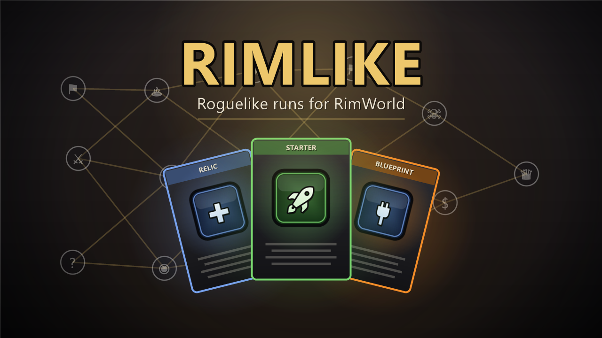

# Rimlike: Roguelike Runs

A RimWorld 1.7 mod that turns the game into a squad roguelike. A run is three acts of nodes laid out across the planet. Pick a path, land your squad, and build a real colony for each node's objective before its weather turns deadly. Between nodes you draft cards, pack only what the squad can carry, and go straight to the next node. Lose the squad and the run is over, but meta points carry over and unlock new starters for the next run.

- **Starters, ideoligion and squad as cards:** New colony opens a card screen for each step of setup.
- **Nodes:** base-building expeditions sized to weeks of play, ambushes, raider camps, escorts, events, rest sites, merchants, treasure, and enemy bases as elites and act bosses.
- **Weather that escalates:** cold, heat, toxic fallout, psychic drones, meteors, tornadoes, hurricanes and floods. Each holds off for a few days, then worsens faster while you fall behind.
- **Rewards:** relics, gear, implants, blueprints, research and recruits, picked from animated cards.
- **Meta progression:** points unlock starters, pool additions and bonuses; winning unlocks Ascension levels that stack handicaps.
- **DLC starters:** Royalty, Ideology, Biotech (one per xenotype) and Anomaly. All are optional.

## Install

1. Requires RimWorld 1.7 and [Harmony](https://steamcommunity.com/sharedfiles/filedetails/?id=2009463077).
2. Download this repository and copy the `Roguelike` folder into `RimWorld/Mods`. The built DLL is included.
3. Enable Harmony, then **Rimlike: Roguelike Runs** below it, and start a **New colony**.

With the mod enabled only roguelike starters are offered; disable it to play standard RimWorld.

## More

- [How to play, build, tune and test](Roguelike/README.md)
- [Design doc and roadmap](docs/roguelike-design.md)

This is an early version. It's covered by in-game self-tests (`Roguelike/Tools/selftest.ps1`), but balance hasn't been playtested much yet.
