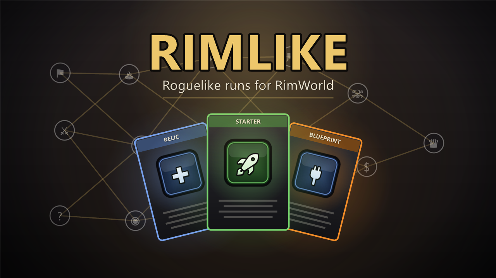

# Rimlike: Roguelike Runs



A run-based squad roguelike for RimWorld 1.7, built from [the design doc](../docs/roguelike-design.md). Pick a starter, land on a node of a branching act shown on a flat act map, clear nodes under worsening weather, draft rewards, and beat the boss. Meta points earned across runs buy unlocks. A second mode, **hub mode**, keeps one colony for the whole run and sends teams out to a frontier that keeps spreading outward.

## Build

```
cd Source
dotnet build -c Release
```

This targets RimWorld 1.7 (`net10.0`, `Krafs.Rimworld.Ref 1.7.5005-unstable`, Harmony from the Workshop) and copies About, Defs, Assemblies and Textures to `RimWorld/Mods/Roguelike`. Pass `-p:DeployDir=none` to skip the copy. A built `Assemblies/Roguelike.dll` is checked in, so the folder works as a mod without building.

## Play

1. Enable **Harmony**, then **Rimlike: Roguelike Runs** below it.
2. **New colony** opens the starter cards: **Crashlanded**, plus any starters you've unlocked (Tribal Hunters, Ice Nomads, and with the DLCs one starter per Biotech xenotype, Mech-tender, Psycaster Exile, Imperial Noble and Void Cultists). With the mod enabled only roguelike starts are offered; disable the mod to play standard RimWorld. → storyteller → world → landing node. With Ideology, pick one of three generated ideoligion cards. Then pick your squad from ten candidate cards that fit the starter, up to the starter's squad size.
3. The whole run is laid out up front on the **act map**: three acts of 15 nodes in rows rising to a boss, each node with an icon for its kind and, for map nodes, its biome. Every node has a random biome, terrain and season (it sits on a random tile of a planet you never see). The **World** button, the **Act map** button under the node panel and **View act map** on the next-node cards all open it; hover a node for its briefing. The landing screen shows act 1's starting nodes as cards (terrain, objective, weather, reward); pick one and **Land here**.
4. Each node has an objective; the panel at the top right shows progress and the weather. Node kinds:
   - **Expedition:** base building: a granary, a crop rotation, a medicine garden, a stone fortress, private quarters, a season with no deaths, and more once blueprints and research unlock them. Each has a short objective (about 8–12 in-game days: get a working camp up) that scales with your squad, plus **stretch goals** (the bigger builds). Each stretch goal met **levels up** a squad member: pick 1 card (a good trait, a passion, +4 in a skill, or losing a bad trait). Once the objective is done you may stay for the stretch goals, but the weather worsens at full speed; leave with **Leave node** under the node panel or on the completion letter.
   - **Ambush:** a raid attacks at once; defeat every enemy.
   - **Raider camp:** a hidden camp across the map. Patrol raids, timed reinforcements and the weather push you to attack.
   - **Escort:** keep a refugee alive for a few days. If they die, the run ends.
   - **Elite:** storm a hostile faction base; the reward is a choice of relics. Bosses are bigger bases with reinforcements.
   - **Event, rest site, treasure, merchant:** resolved on the spot over the act map, no map. Rest sites heal, train or treat; treasure gives relics; merchants sell cards for the silver your caravan carries.
5. The modifier (cold, heat, toxic buildup, a psychic drone, meteors, tornadoes, a hurricane or a tidal surge on the coast) holds off for a grace period, then worsens every day with no cap: slower while you're ahead of pace, faster while behind. **Raids are announced:** expeditions and raider camps raid on a schedule, and the node panel shows the next one (when, from which side, about how many) with a red ring where it will walk in once it's under two days away. The storyteller's surprise raids are off on node maps. **Road wear:** every cleared node with a map wears the squad down a little (slower work and movement, and at its worst a duller mind); only **Rest** at a rest site clears it.
6. Clearing a node opens the reward screen: pick 1 card (relic, gear, implant, blueprint, research or recruit) or skip. Research cards finish a project right away, favouring ones that open gated objectives. Relics come in common, uncommon and rare. Recruit nodes offer only recruits. Un-drafted blueprint groups are hidden from the build menu.
7. Then pick your next node from the cards (one per connected node), and pack on the packing screen: item tiles by category (click to add, right-click to remove, shift for all or none), **Essentials** and **Most valuable** presets, and a carry meter that won't let you pack past what the squad and pack animals can carry. **Back to the node choice** returns to the cards. The squad goes straight into the chosen node, no travel. Choosing a node skips its siblings. Closed the cards by accident? Use **Leave node now** on the completion letter.
8. Beating an act boss gives a card and lays out the next, harder act nearby. The run is won on the act-3 boss and lost on a squad wipe, a failed escort, or leaving a node early. The end-of-run screen shows stats and points, with **New run** to start again on the same world: choose a starter (last run's is preselected), then ideoligion and squad.

### Hub mode

Pick **Hub: one colony, an endless frontier** under the starter cards (the choice is remembered). Then:

1. Choose your hub from three hub-site cards. It's your colony for the whole run, with no objective of its own. Four frontier nodes appear around it.
2. **Frontier map** (hub panel, or the World button): the act map drawn radially. Your hub sits in the centre and each step out is a ring; scroll to zoom and drag to pan. **Send a team** (top right, on the hub): pick a frontier node from its card, then pick who goes on the packing screen (click portraits). Everyone else keeps the hub running. Only one team can be out on the frontier at a time.
3. The team plays the node as usual. Afterwards it picks a reward and packs for home. Map-less nodes (events, merchants, rest sites, treasure) send the team straight home. **Pull back to hub** leaves a node early: no reward, and the node stays open. Failing a node reopens it too. Only losing every colonist ends the run.
4. Clearing a node reveals 2–3 more further out, harder with each step (depth). One of the nodes at depth 3, 6, 9… is an elite, and depths 5 and 10 hold a single boss. The final boss waits at depth 15. Beating it wins the run, and **Keep going** carries on endless.
5. The hub's weather keeps worsening until frontier nodes push it back: quick nodes halve it, while expeditions, elites and bosses break it (a new one rolls in after a grace period). Sieges hit the hub every 12 days, announced a day ahead.
6. **Harvest trip**: send a side team back to a cleared node (not an enemy base). Its map comes back fresh with no objective, clock, reward or weather relief.

**Meta points:** +1 per node cleared, +5 per boss, +1 per skipped reward. Spend them from the end-of-run screen or in **Options → Mod settings → Roguelike** on starters, extra relics/blueprints/gear in the pools, and permanent bonuses. Progress is stored in the mod settings file, not in saves. Winning unlocks the next **Ascension** level (up to 5), chosen in the same list; each level stacks a handicap.

Debug helpers (Development mode): the caravan float menu has **(Dev: instantly)**; debug actions **Roguelike → Enter test node...**, **Complete node objective**, **Advance threat 1 day**.

## Tuning

All content is XML in `Defs/`, no recompile needed:
- `Roguelike_Prototype.xml`: weather modifiers, node presets (kind, objective, modifier and its rate, grace, pace, enemy pressure), events, the Crashlanded run scenario.
- `Roguelike_Rewards.xml`: relics, gear and implant rewards, blueprint groups.
- `Roguelike_Meta.xml`: starter scenarios and unlocks.
- `Roguelike_Disasters.xml`: meteor, tornado, hurricane and tidal-surge modifiers and their nodes.
- `Roguelike_Overhaul.xml`: the road wear hediff and its stages.
- `Roguelike_DLCStarters.xml`: DLC starters, their relics and unlocks (generated; loads only with each DLC).

Art is generated, no assets are copied from anywhere: `Tools/make-node-icons.ps1` (world-map node icons), `Tools/make-unlock-icons.ps1` (unlock and starter badges) and `Tools/make-mod-art.ps1` (`About/ModIcon.png` and `About/Preview.png`). UI textures are made in code (`Source/Style.cs`).

Act shape (row sizes) is in `Source/RunMap.cs`; the act map screen is `Source/RunMapScreen.cs`; hub-mode depths, siege timing and frontier layout are in `Source/Hub.cs`.

## Self-test

`Tools/selftest.ps1 -Mode <mode> [-Scenario <ScenarioDef>] [-OutDir <dir>]` launches RimWorld with `-quicktest -roguelikeSelfTest=<mode>`, which starts a run on a starting node and drives it from `Source/SelfTest.cs`. Results are `[RLTEST]` lines in the player log; screenshots are saved as `rltest_*.png`. The script backs up your mod list, enables Harmony + this mod for the run, and restores it afterwards. Meta progress is reset in memory only and never written. Close RimWorld first.

| Mode | Covers |
|---|---|
| `win` | Act graph (incl. varied biomes), travel, staying for stretch goals then leaving, road wear, rewards after each node, map-less nodes on the path, all three acts and their bosses, winning |
| `leave` | Leaving a node early ends the run |
| `wipe` | Losing the squad ends the run |
| `rewards` | Card screen (incl. a mid-pick screenshot), every reward kind incl. research, relic effects, blueprint build-menu gate |
| `variety` | Every node kind, objective and weather modifier, every event, stretch goals and level-ups, announced raids (and no surprise raids), road wear cleared at rest |
| `meta` | Points, buying unlocks, locked content, toggling variety unlocks, stacking relics, gear sets, unlock badges, end-of-run and unlock screens |
| `meta` (also) | Ascension effects and unlocking |
| `starter` | With `-Scenario <ScenarioDef>` (any roguelike starter, including the DLC ones): pawns, xenotypes, kit and signature relic |
| `newrun` | Wipe, vanilla game-over suppressed, New colony and New run open the starter cards, then the ideoligion and squad cards, into a fresh run with exactly the chosen squad and ideoligion |
| `disasters` | Meteor aftermath, tornado, hurricane, tidal surge |
| `polish` | Node icons, act map (covers the world, World button), HUD panel, relic rarity |
| `hub` | Hub mode: hub sites, frontier reveal and depth rules, team split, return home, pull back and failure, hub weather relief, map-less nodes, harvest trips, sieges, save and load, final boss and endless |

## Known gaps

- Only 6 of the 20 gated objective candidates from the pacing research are in.
- Card art is vanilla item icons on procedural card frames; node icons are simple generated glyphs.
- Several DLC signature relics are simplified versions of the design (see the design doc).
- Level-ups grant traits from a short good list and remove ones from a short bad list (`Source/Overhaul.cs`), not from XML.
